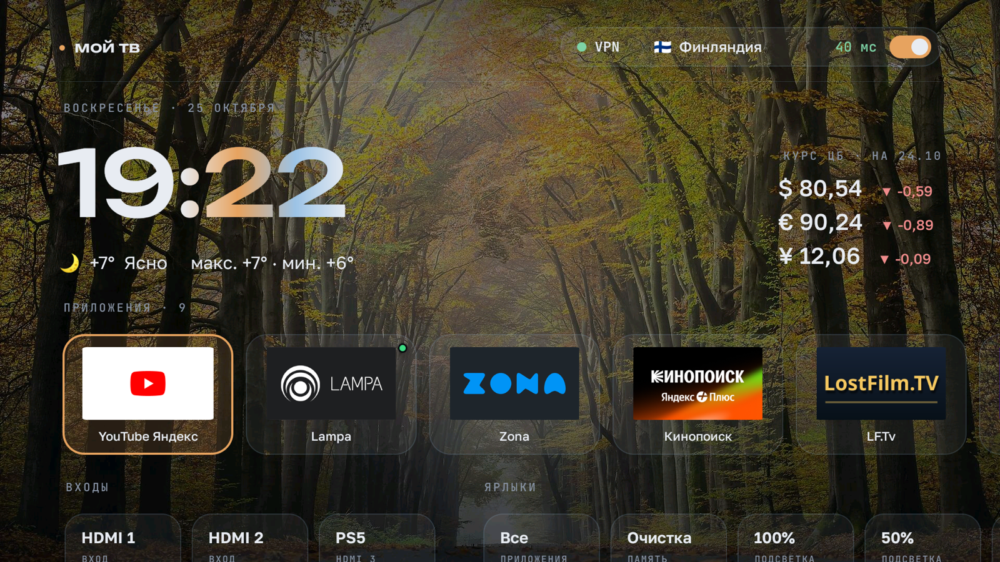
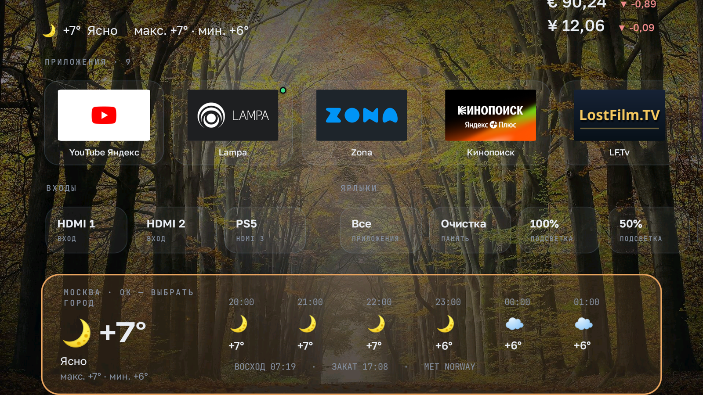
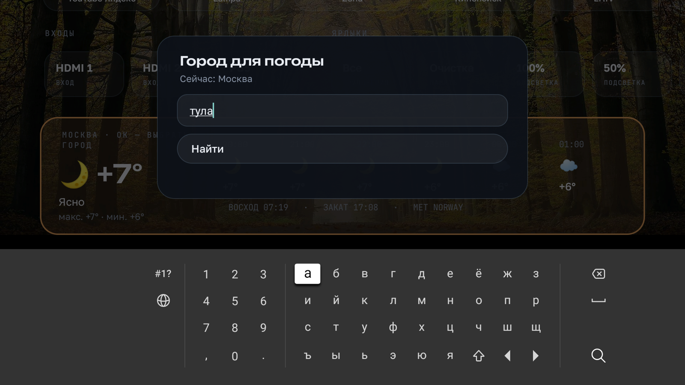
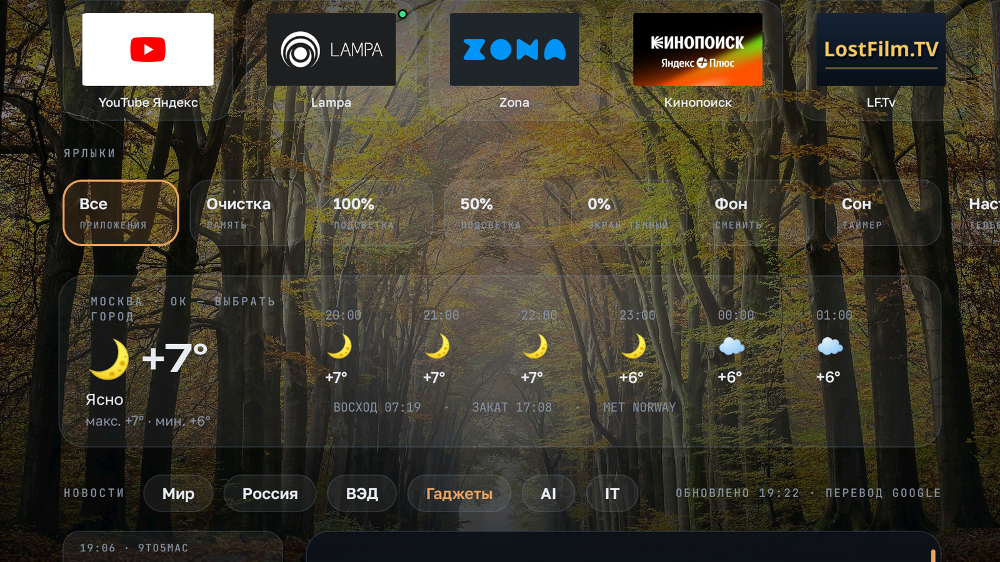
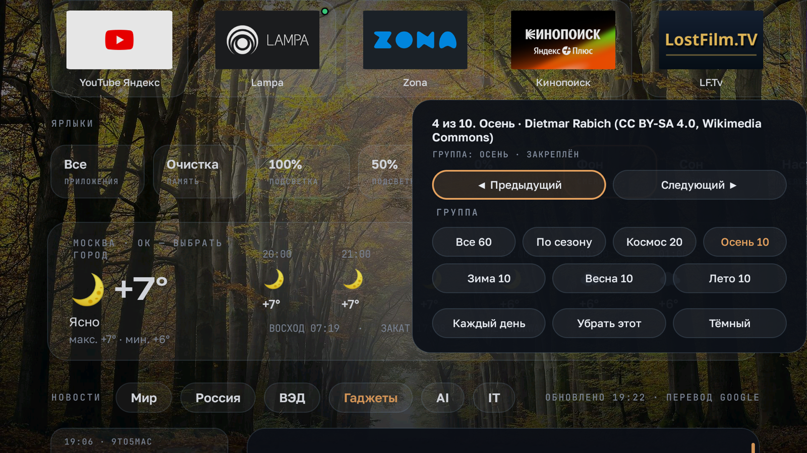

# Мой ТВ

Домашний экран для телевизоров на YaOS (Яндекс ТВ, Android 9). Ставится вместо экрана Яндекса: без рекламы и подборок, с погодой, курсами валют, новостями и пультом в телефоне. Root не нужен, всё ставится по Wi-Fi с компьютера за 10–15 минут.



Проверено на **Hartens HTY-50UHD11B-S2** (YaOS на Android 9, процессор MediaTek, 1,3 ГБ памяти). На других телевизорах с YaOS лаунчер должен запуститься, но входы HDMI, подсветка и таймер сна завязаны на прошивку и могут не работать. Если проверили на своей модели, напишите в [Issues](../../issues), добавлю в список.

## Что на экране

- Часы, дата, погода по выбранному городу на 6 часов вперёд, восход и закат.
- Курсы доллара, евро и юаня ЦБ РФ с датой курса.
- Новости в шесть вкладок: Мир, Россия, ВЭД, Гаджеты, AI, IT. Статья открывается целиком справа от списка, английские тексты переводятся на русский. Показываются новости только за сегодня и вчера.
- Строка приложений без рекламы: свой порядок, скрыть, остановить. Зелёная точка в углу плитки значит, что приложение висит в фоне и его можно остановить.
- Входы HDMI 1–3 одной кнопкой, их можно переименовать (например, в «PS5»).
- Ярлыки: все приложения, очистка памяти, подсветка 100 / 50 / 0 %, смена фона, таймер сна, настройки ТВ, пульт с телефона.
- Пульт и ввод текста с телефона: открываете страницу в браузере телефона, там крестовина, ОК, громкость и поле для текста.
- 60 фонов: космос (NASA, Hubble, Webb, ESO) и четыре времени года. Фон меняется раз в день или закрепляется.
- Если установлен клиент прокси Happ: переключатель, страна сервера и задержка.

Подробно о каждой функции: [docs/FEATURES.md](docs/FEATURES.md).

| | |
|---|---|
|  |  |
|  |  |

## Установка

Нужен компьютер с Mac, Windows или Linux в той же Wi-Fi сети, что и телевизор.

1. Включите на телевизоре ADB по сети: [docs/INSTALL.md](docs/INSTALL.md#1-включить-adb).
2. Узнайте IP телевизора: [docs/INSTALL.md](docs/INSTALL.md#2-узнать-ip-телевизора).
3. Скачайте этот репозиторий: зелёная кнопка **Code → Download ZIP**, распакуйте.
4. Запустите установку:
   - **Mac или Linux:** откройте Терминал и выполните
     ```
     cd ~/Downloads/moy-tv-main
     bash scripts/install.sh
     ```
   - **Windows:** откройте папку `windows` и дважды щёлкните `install.bat`.
5. Скрипт спросит IP телевизора. На экране ТВ появится запрос «Разрешить отладку?»: выберите «Всегда» и нажмите ОК.
6. Нажмите HOME на пульте. Затем ОК на карточке погоды → «Сменить город».

Готовый APK лежит в [Releases](../../releases/latest), его можно поставить и вручную, но тогда лаунчер не получит нужных прав. Лучше через скрипт.

## Что ещё стоит сделать

- [docs/TWEAKS.md](docs/TWEAKS.md): что отключить в YaOS, чтобы ТВ работал быстрее (Алиса, реклама, заставка, фоновые приложения). Всё одним скриптом `tweaks`, каждый пункт с подтверждением.
- [docs/APPS.md](docs/APPS.md): какие приложения поставить и откуда их брать.

Вернуть всё как было: `bash scripts/undo.sh` или `windows\undo.bat`.

## Безопасность

- Лаунчер не собирает статистику и никуда не отправляет данные о вас. Он обращается только к сервисам погоды (api.met.no, Open-Meteo), поиску городов (Open-Meteo, OpenStreetMap), курсам ЦБ (cbr-xml-daily.ru), RSS-лентам новостей и Google Переводчику для иностранных статей.
- Пульт с телефона работает через страницу на телевизоре (порт 8080) с четырёхзначным кодом. Кто знает код и сидит в вашей Wi-Fi сети, может нажимать кнопки на ТВ.
- Чтобы нажимать кнопки, лаунчер подключается к ADB самого телевизора. ADB по сети при этом остаётся включённым, поэтому подключайте ТВ только к домашней сети.
- Права, которые скрипт выдаёт лаунчеру: менять системные настройки (подсветка, экран HOME), читать список запущенных процессов (зелёные точки), служба специальных возможностей (кнопки пульта и ввод с телефона).

## Сборка из исходников

```
bash scripts/build.sh
bash scripts/install.sh build/moy-tv.apk
```

Скрипт сам скачает Java 17 и инструменты Android SDK (около 500 МБ) в папку `.tools`, Android Studio и Gradle не нужны. Код на Java без сторонних библиотек: [launcher/src](launcher/src/ru/mikulinskiy/tvhome).

Собранный вами APK подписан вашим ключом. Чтобы поставить его поверх версии из Releases, сначала удалите старую.

## Лицензии

Код: MIT, см. [LICENSE](LICENSE). Шрифты Unbounded, Golos Text и JetBrains Mono: SIL Open Font License 1.1. Фоны: NASA (общественное достояние), ESA/Hubble, ESA/Webb, ESO (CC BY 4.0), снимки с Wikimedia Commons (CC BY и CC BY-SA). Авторы всех снимков: [docs/CREDITS.md](docs/CREDITS.md).

Автор: Андрей Микулинский, [mikulinskiy.ru](https://mikulinskiy.ru).
