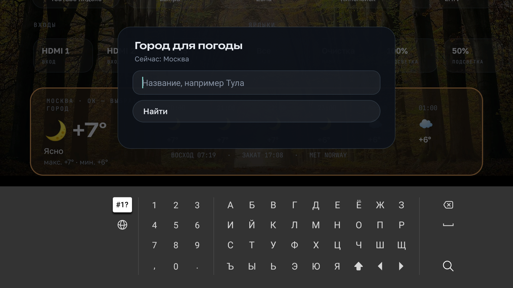
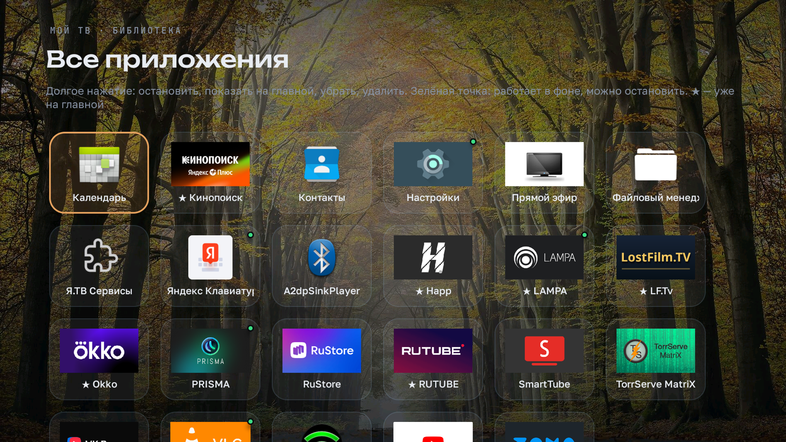
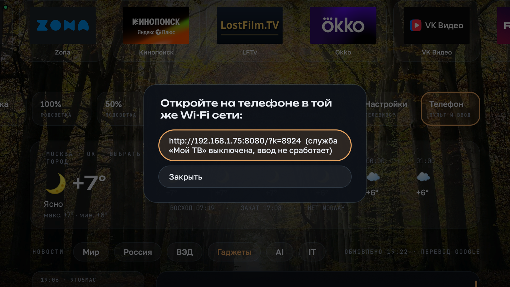

# Возможности

Управление обычным пультом: стрелки, ОК, «Назад». Долгое нажатие ОК открывает дополнительное меню там, где оно есть.

## Верхняя строка

- **Часы и дата.** Пока телевизор не получил время из интернета (первые секунды после включения), вместо времени показывается `--:--`, а не случайные цифры.
- **Курсы ЦБ РФ.** Доллар, евро и юань, рядом стрелка изменения и дата, на которую ЦБ установил курс. Источник: cbr-xml-daily.ru.
- **Плашка VPN** (появляется, только если установлен клиент Happ). ОК включает и выключает соединение, долгое ОК открывает Happ. Показывает страну сервера и задержку в миллисекундах. VPN выключается сам, когда телевизор уходит в ожидание.

## Погода

Текущая температура, максимум и минимум за день, прогноз на 6 часов, время восхода и заката. Данные берутся из MET Norway (yr.no), при ошибке из Open-Meteo. Обновляются раз в 30 минут.

ОК на карточке открывает меню: «Обновить погоду и курсы» или «Сменить город». Город ищется по названию через Open-Meteo, а если этот сервис недоступен, через OpenStreetMap.

## Приложения

Строка любимых приложений. При первом запуске туда попадают установленные из списка: SmartTube, YouTube Яндекса, Lampa, Кинопоиск, Okko, VK Видео, Rutube, Zona, Happ.

Долгое ОК на плитке:

- **Остановить** закрывает приложение. Если оно держит службу на переднем плане (например, VPN или торрент-сервер), откроется системный экран «О приложении» с кнопкой «Остановить».
- **Скрыть с главной.**
- **Сдвинуть влево / вправо.**

Зелёная точка в правом верхнем углу плитки значит, что приложение работает в фоне и занимает память. Точки нет у системных приложений и у тех, что держат службу на переднем плане.

## Входы

HDMI 1, 2, 3 переключаются одной кнопкой. Подпись берётся из системного меню источников, так что переименованный там вход («PS5») будет подписан так же.

## Ярлыки

| Ярлык | Что делает |
|---|---|
| Все | Все приложения сеткой. Долгое ОК: остановить, добавить на главную или убрать, удалить |
| Очистка | Закрывает фоновые приложения и показывает, сколько памяти освободилось |
| 100 % / 50 % | Яркость подсветки |
| 0 % | Гасит экран, звук продолжает играть. Любая кнопка включает экран обратно |
| Фон | Меню фонов (ниже) |
| Сон | Таймер сна на 30, 60 или 90 минут, «Выключить сейчас». Подпись показывает, сколько осталось. За минуту до выключения появляется предупреждение |
| Настройки | Системные настройки телевизора |
| Телефон | Адрес пульта для телефона |

## Фоны

60 снимков: 20 из космоса (NASA, ESA/Hubble, ESA/Webb, ESO) и по 10 на каждое время года с Wikimedia Commons. В меню:

- листать вперёд и назад;
- выбрать группу: Все, По сезону (берёт текущее время года), Космос, Осень, Зима, Весна, Лето;
- «Каждый день» или «Закрепить этот»;
- «Убрать этот», если снимок не нравится, и «Вернуть убранные»;
- «Тёмный» вместо снимка.

В заголовке меню написано, что на снимке и кто автор.

## Новости

Блок под погодой. Шесть вкладок:

| Вкладка | Источники |
|---|---|
| Мир | Интерфакс, раздел «В мире» |
| Россия | Интерфакс, без спорта |
| ВЭД | Альта-Софт (новости и законодательство), Ведомости и Интерфакс с отбором по словам: экспорт, импорт, таможня, пошлины, санкции, логистика, порт, фрахт, ЕАЭС |
| Гаджеты | GSMArena, 9to5Mac, Android Authority |
| AI | Ars Technica, TechCrunch, MIT Technology Review |
| IT | Ars Technica, TechCrunch |

Слева список заголовков, справа выбранная статья целиком. Стрелки вверх и вниз листают статью по трети экрана. Гаджеты, AI и IT переводятся на русский через Google Переводчик. Показываются только новости за сегодня и вчера. Если источник не открывается (бывает без VPN), он пропускается без ошибки.

## Пульт и ввод с телефона

Ярлык «Телефон» показывает адрес вида `http://192.168.1.50:8080/?k=1234`. Откройте его в браузере телефона в той же Wi-Fi сети. На странице:

- крестовина, ОК и «Долгое ОК», «Назад», «Домой», пауза и воспроизведение, громкость, «Без звука»; стрелки и громкость повторяются при удержании;
- поле для текста: что напечатаете на телефоне, появится в поле ввода на ТВ, кириллица работает.

Как это устроено: лаунчер подключается к ADB самого телевизора (127.0.0.1:5555) и нажимает кнопки через системный InputManager. Поэтому при первом нажатии ТВ спросит разрешение на отладку.

## Чего лаунчер не умеет

Проверено, без root не обойти:

- переназначить кнопку микрофона на пульте: её перехватывает защищённая служба Яндекса;
- голосовой поиск без Алисы: на YaOS нет сервисов Google;
- блок «Продолжить просмотр»: приложения на этой прошивке не отдают историю просмотров.
